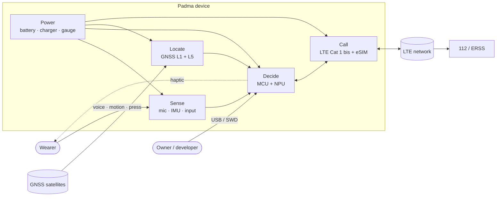
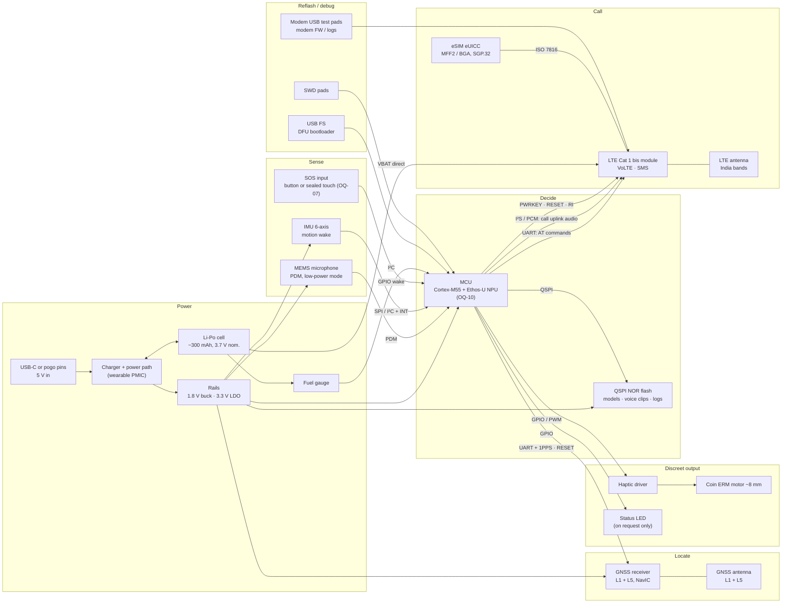
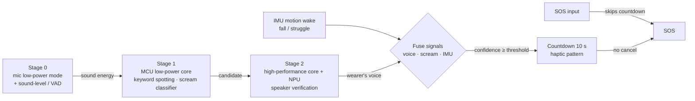
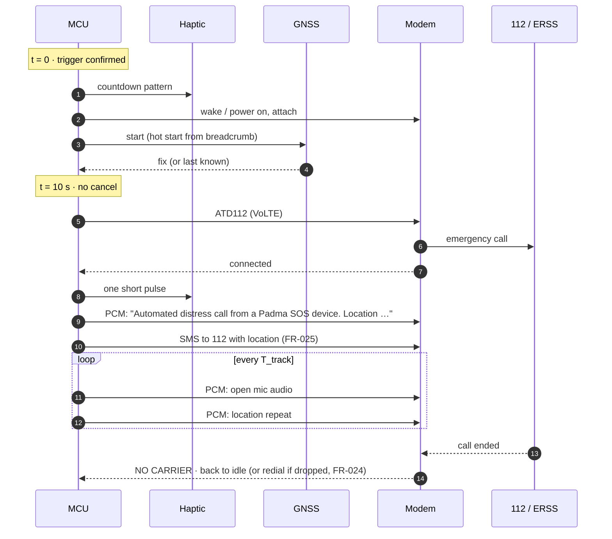

# 01 · System Block Diagram

Status: `draft`

## Level 0: device in context

The device has four jobs: **sense** (microphone, IMU, input), **decide** (MCU), **locate** (GNSS) and **call** (LTE modem + eSIM). Power and the debug/reflash interfaces support all four.

## Level 1: blocks and interfaces

### Interface summary

| From → To | Interface | Carries | Notes |
|---|---|---|---|
| Mic → MCU | PDM | All audio: detection and call uplink | One mic for both jobs (AD-01) |
| MCU → Modem | UART | AT commands, SMS, call control, status | Hardware flow control; RI line wakes the MCU |
| MCU → Modem | I²S / PCM, 8 or 16 kHz | Announcement, then live mic audio | Downlink is ignored because there is no speaker (FR-022) |
| MCU → Modem | GPIO | PWRKEY, RESET, (DTR for sleep) | The MCU owns the modem's power state (AD-05) |
| eSIM → Modem | ISO 7816 (SIM) | Operator profile | RSP is driven over AT / LPA (FR-046) |
| MCU ↔ GNSS | UART (+ 1PPS) | NMEA / binary fixes, assistance data | Separate receiver (AD-04) |
| MCU ↔ IMU, gauge | SPI / I²C + interrupts | Motion events, state of charge | |
| MCU → Flash | QSPI | Model weights, voice clips, event log, OTA staging | |
| Host → MCU | USB FS, SWD | Reflash, debug | Documented, owner-controlled (FR-042, NFR-043) |
| Host → Modem | USB test pads | Modem firmware, RF logs | Factory / developer only, not exposed |

## Detection wake chain

Each stage runs only when the previous one fires, so the expensive stages almost never run (R-03).

## SOS timeline

The modem boots and registers **during the 10 s cancel window**, so a modem that is off or asleep while idle does not delay the call much (see AD-05 and the power budget).

A manual SOS skips the countdown, so the modem's start-up time lands directly on the ≤ 15 s budget in NFR-020. This is the main argument against switching the modem fully off (AD-05).

## Architecture decisions

| ID | Decision | Why | Serves | Status |
|---|---|---|---|---|
| AD-01 | **One microphone, routed through the MCU.** The MCU takes the PDM mic and feeds the modem's digital audio input (I²S / PCM). The modem's analog mic input is unused. | One mic serves both detection and the call. The MCU can mix the announcement and location repeats into the uplink without an analog switch. Needs a modem with a digital audio interface that works in a VoLTE call (A-04). | FR-021, FR-022, FR-023 | proposed |
| AD-02 | **Announcement built from pre-recorded English clips**, not a TTS engine. Clips: the fixed sentence, digits 0–9, "point", "north", "east", "DIGIPIN", and the 16 DIGIPIN symbols. DIGIPIN is computed on-device from lat/long. | Small (tens of kB compressed), deterministic, and clear on a narrowband call. No TTS model on the MCU. | FR-021, OQ-13 | proposed |
| AD-03 | **Separate application MCU**; the modem is only a peripheral (no OpenCPU). | Speaker verification needs an NPU-class MCU (OQ-10). Keeps the reflashable platform independent of a modem vendor's SDK (FR-042) and lets us change modem. Costs one extra chip and some board area. | FR-002, FR-042 | proposed |
| AD-04 | **Separate dual-band GNSS receiver** (L1 + L5) instead of the modem's built-in GNSS. | NavIC is on L5; built-in GNSS on Cat 1 bis modules is usually L1-only and often has no NavIC. Some modules also can't run GNSS during a call. To verify per candidate. | FR-030, FR-031 | proposed |
| AD-05 | **Modem idle strategy:** (a) registered with DRX, (b) PSM / eDRX, or (c) off and booted on trigger. | The largest standby lever (see [02-power-budget.md](02-power-budget.md)). The device never needs to receive calls, so (b) or (c) is possible, but it adds attach time to a manual SOS and limits OTA. | NFR-010, NFR-020 | **open** |
| AD-06 | **Separate LTE and GNSS antennas**, chosen from an early antenna study; consider using the pendant lanyard or ring as part of the LTE antenna. | A body-worn, watch-sized enclosure is the hardest RF case (R-05). LTE bands below 1 GHz (B5 / B8) need the most space. | R-05, NFR-001 | proposed |
| AD-07 | **Battery feeds the modem directly (VBAT)**; buck / LDO only for the low-voltage parts. | Cat 1 bis modules run from 3.3–4.3 V and draw high peaks in Tx bursts; a regulator in that path wastes area and adds dropout. | NFR-010 | proposed |
| AD-08 | **Two-stage detection** (low-power core always on; NPU core only on a candidate), gated by the mic's own sound detection. | Keeps the average detection current under ~1 mA (R-03). The dual-core Cortex-M55 parts suit this. | FR-002, FR-003, R-03 | proposed |

## Candidate parts (to evaluate)

These are starting points for the shortlist, not selections. Each needs a datasheet check against the criteria listed.

| Block | Example families | Must check |
|---|---|---|
| LTE Cat 1 bis module | Quectel EG915U-CN (lead), Telit ELS62-I (second source); see [03-lte-module-selection.md](03-lte-module-selection.md) | India band variant (B1 / B3 / B5 / B8 / B40 / B41), VoLTE on Jio and Airtel, PCM / I²S audio in a VoLTE call, downlink mute, eSIM / LPA support, TEC MTCTE, idle current in DRX / eDRX / PSM, size |
| GNSS receiver | Airoha AG3335-based modules (e.g. Quectel LC29H / LC76G families) | NavIC L5 actually enabled on that variant, BeiDou can be switched off, hot-start current, size |
| MCU | Alif Ensemble E1 / E3 (Cortex-M55 + Ethos-U55, low-power + high-performance cores) | Always-on current with keyword spotting, USB FS, SRAM for speaker verification, package size, open toolchain |
| Microphone | Low-power PDM MEMS mics with a sound-detect / wake mode | Low-power-mode current, SNR, IP-rated acoustic membrane |
| IMU | ST LSM6DSO-class (motion wake, on-chip ML core) | Current in wake-on-motion mode |
| Charger / PMIC | TI BQ2512x-class wearable PMIC | Integrated buck / LDO, ship mode, quiescent current |
| Fuel gauge | MAX17048-class | Quiescent current |
| eSIM | MFF2 / WLCSP eUICC with SGP.32 | Profiles from Jio / Airtel / Vi with voice + SMS (A-02) |
| Haptic | 8 mm coin ERM + driver or MOSFET | Current, size |

## Open points raised by this draft

- **A-04 is now load-bearing.** AD-01 and AD-02 rely on the modem accepting digital audio into the uplink of a VoLTE call (including emergency calls) and muting the downlink. This should be the first test on any modem evaluation board.
- **AD-05** needs a measurement: modem attach time from off and from PSM on Jio and Airtel in Delhi, against the 15 s manual SOS budget.
- **OQ-07 (button)** affects the wake chain: without a button, the "SOS input" is a sealed touch area or an IMU squeeze, and the long-press stop (FR-026) has to work on that input.
