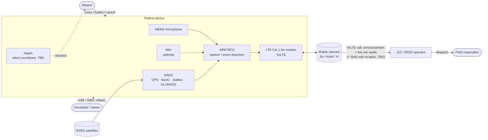
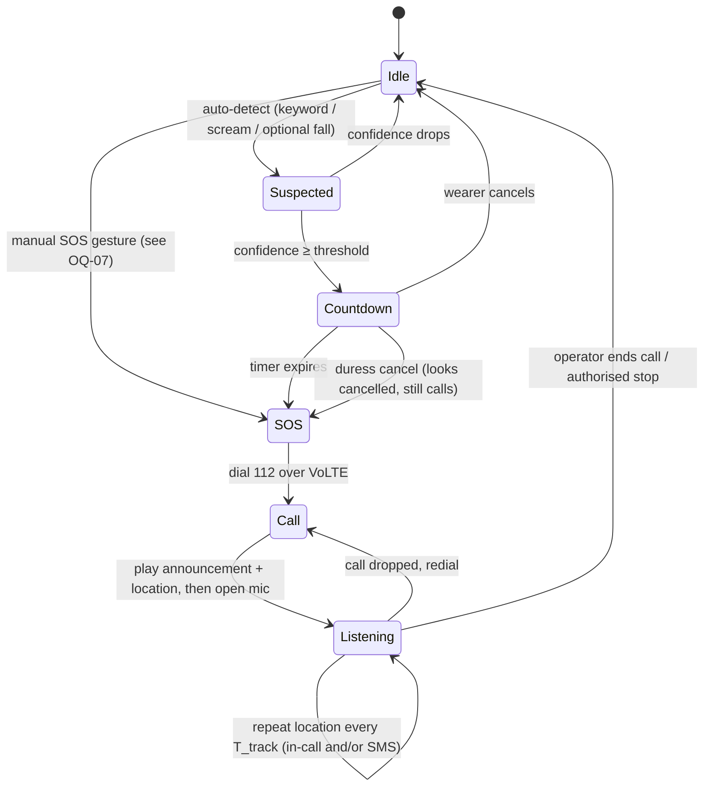

# 03 · Use Cases

Status: `draft`

## System context

## SOS state flow

Everything is **silent**: no buzzer, no siren, no speaker output.

## Use cases

| ID | Use case | Trigger | Priority |
|---|---|---|---|
| UC-01 | **Manual SOS:** wearer deliberately raises an alarm | Button / press pattern | M |
| UC-02 | **Automatic SOS, fall:** wearer falls or is pushed down | IMU | C (was M; IMU now optional, see OQ-16) |
| UC-03 | **Automatic SOS, struggle:** wearer is grabbed or dragged | IMU | C |
| UC-04 | **Automatic SOS, voice:** wearer screams or says a keyword (e.g. "bachao" / "help") | Microphone + on-device speech / sound recognition | **M** (primary auto trigger) |
| UC-05 | **Cancel a false alarm** during a **silent** countdown | Wearer cancel gesture | M |
| UC-06 | **Duress cancel:** device looks cancelled but still calls | Alternate cancel gesture | C |
| UC-07 | **Location to responders:** first fix plus repeated updates while she is moved | SOS active | M |
| UC-08 | **Listen-in call to 112:** automated announcement, then the operator listens through the open mic (no audio played on the device) | SOS active | **M** |
| UC-09 | **Device removed / tampered** during SOS | Tamper sensor | C |
| UC-10 | **Low location quality** (indoors, metro): fall back to cell / Wi-Fi | GNSS has no fix | S |
| ~~UC-11~~ | ~~Notify trusted contacts by SMS~~ | Dropped for v1 (user decision) | W |
| UC-12 | **Daily wear:** charge, check status | Routine | M |
| UC-13 | **Setup:** SIM / eSIM activation, configuration | First use | M |
| UC-14 | **Low-battery behaviour:** reserve energy for one full SOS | Battery threshold | M |
| UC-15 | **Reflash / repurpose:** owner or developer installs custom firmware for other uses that help people | Developer | **M** |

## Use case detail

### UC-04: Automatic SOS, voice (primary)

- **Pre-conditions:** device worn and armed; battery above the reserve level.
- **Main flow:**
  1. An always-on low-power audio front end (microphone voice-activity or sound-level wake) wakes the MCU.
  2. The MCU runs on-device keyword spotting / scream classification; nothing is recorded or uploaded.
  3. Confidence ≥ threshold: **silent countdown** (haptic, if fitted) for T_cancel seconds.
  4. No cancel arrives: the GNSS fix is taken (or the last known one).
  5. The modem dials **112 over VoLTE**.
  6. On answer, the device injects an **announcement into the call**, e.g. *"Automated distress call from a Padma GPS device. Location: …"*, then switches to **open mic**.
  7. The location is repeated every T_track (in-call announcement and/or SMS to 112; see OQ-02).
- **Alternate flows:** wearer cancels in step 3 (UC-05); call fails or drops, so it redials with backoff; no GNSS fix, so UC-10.
- **Post-conditions:** the operator has heard the context, the location and live audio; the event is logged on the device.
